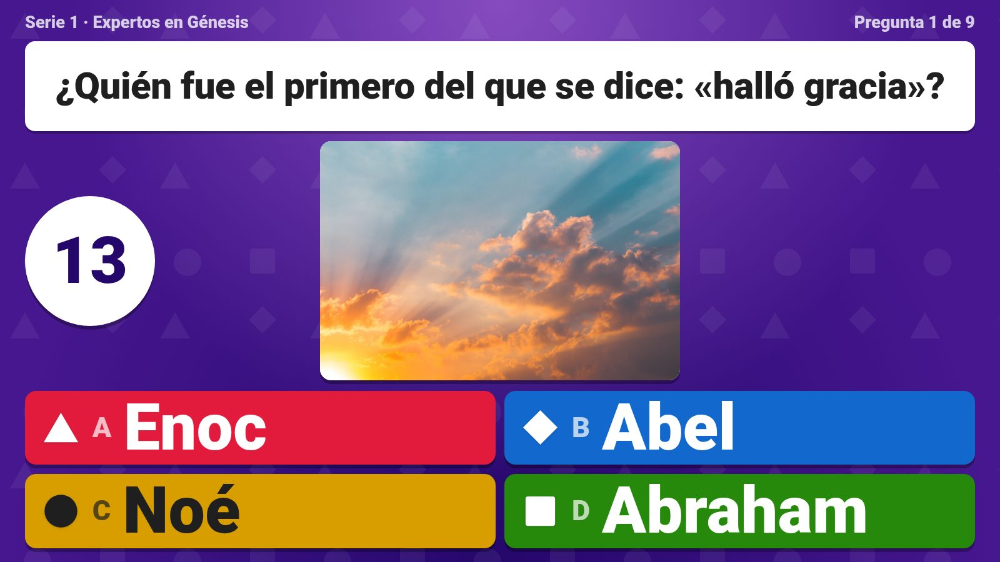
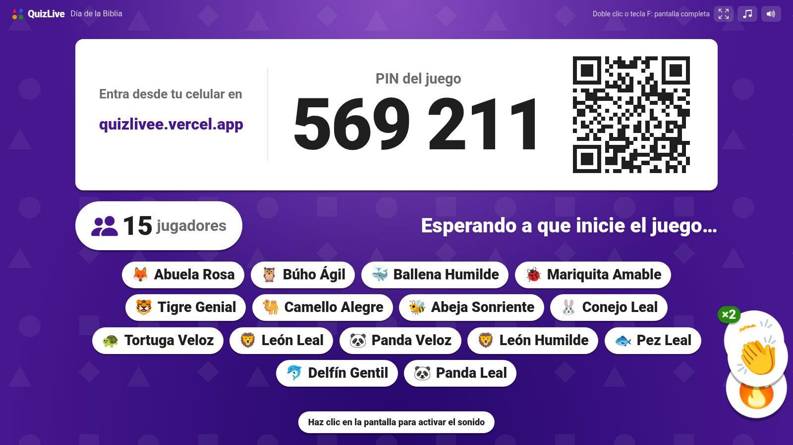
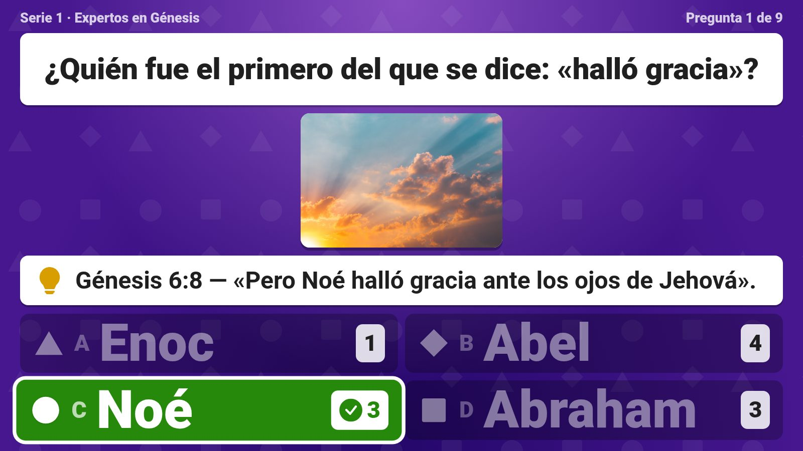
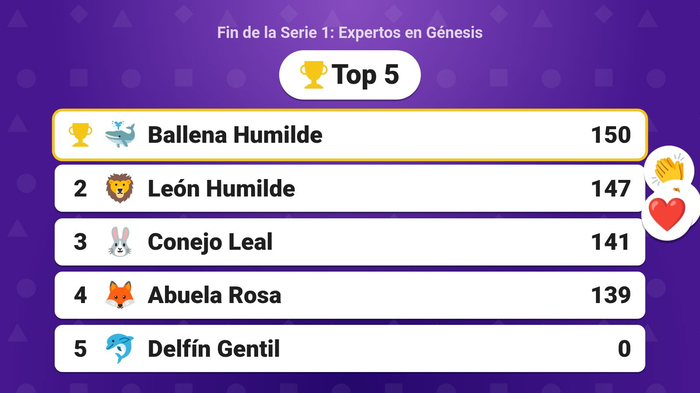
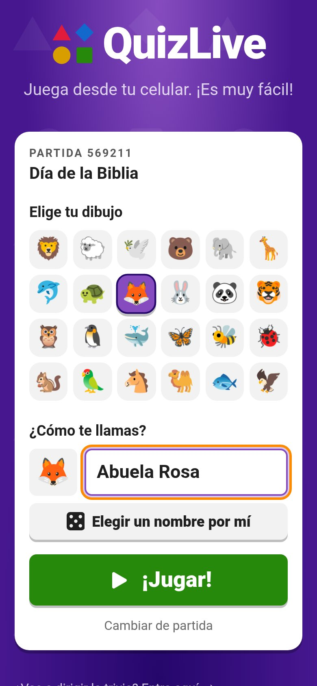
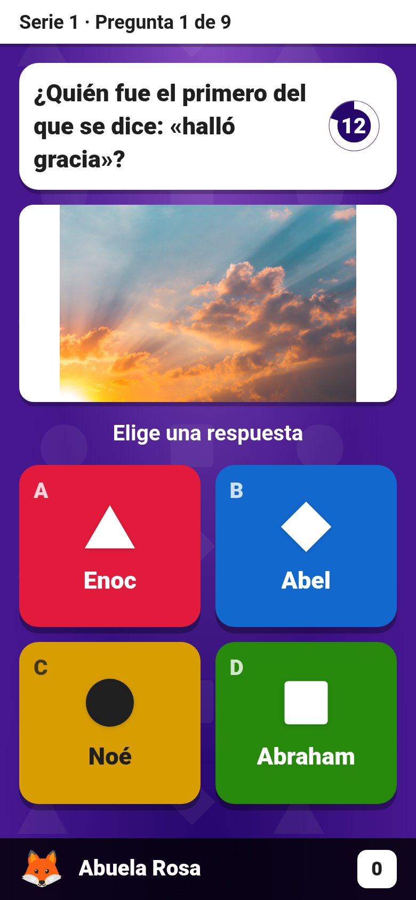
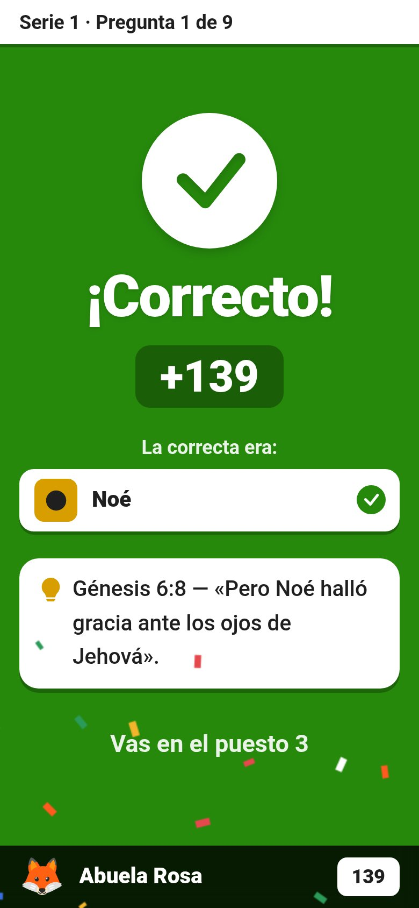
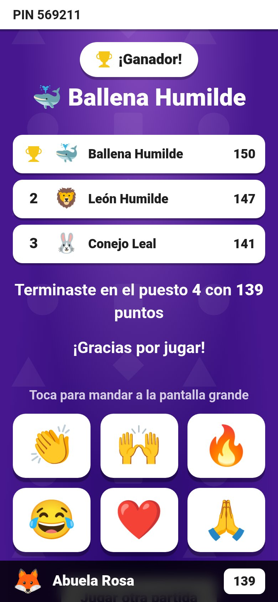
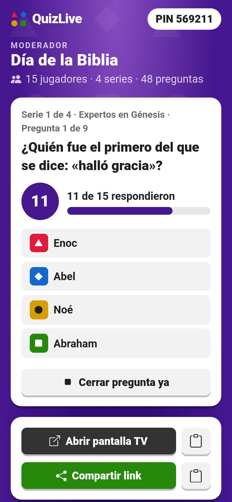
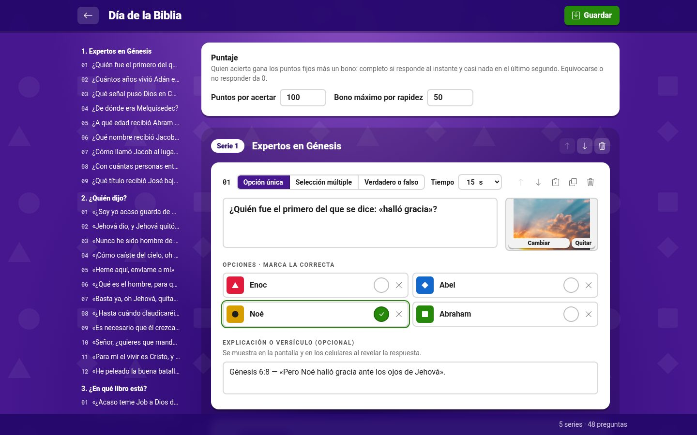

# QuizLive

Trivias en vivo tipo Kahoot para eventos de la iglesia, como el **Día de la Biblia**. Está pensada para todas
las edades (de niños a abuelos) y para salas grandes con datos móviles: se probó con 120 jugadores a la vez.

**Para jugar:** [quizlivee.vercel.app](https://quizlivee.vercel.app)

<p align="center">
  
</p>

## Cómo se juega

Hay **tres pantallas sincronizadas**:

| Pantalla | Dirección | Para qué |
|---|---|---|
| **TV** | `quizlivee.vercel.app/tv/PIN` | Lo que ve el público: QR, pregunta, tiempo, respuesta, top 5 y ganador. No tiene botones. |
| **Moderador** | `quizlivee.vercel.app/host` | Desde el celular: abre la sala, comparte el link y da «Siguiente». También sirve para preparar las trivias. |
| **Participantes** | `quizlivee.vercel.app` | Entran con el link o el PIN, eligen un dibujo y un nombre, y responden. |

1. El moderador abre la sala y pone la pantalla TV en el televisor.
2. La gente escanea el QR (o escribe el PIN) y elige su dibujo y su nombre.
3. Las preguntas van por **series**. Al final de cada serie sale el **top 5**, y al final del juego, el **ganador**.

## Capturas

### Pantalla TV

| Sala de espera | Inicio de serie |
|---|---|
|  |  |
| **Respuesta y versículo** | **Top 5 al terminar la serie** |
|  |  |

<p align="center"></p>

### Celular del participante

| Entrar | Responder | Resultado | Top 5 | Final |
|---|---|---|---|---|
|  |  |  |  |  |

### Moderador y editor

| Moderador: sala | Moderador: pregunta |
|---|---|
|  |  |



## Lo que trae

- **Entrada rápida para 100 personas:**
  - El QR lleva directo a elegir el nombre.
  - El PIN se busca solo al escribir el 6.º número.
  - Hay un dado (🎲) que inventa un nombre.
  - Los nombres repetidos se numeran en lugar de dar error.
- **Para todas las edades:** letra grande en el celular, opciones con color, figura y letra (A/B/C/D),
  textos sencillos y un ícono grande de ✓ o ✗ al responder.
- **Pantalla TV a todo tamaño:** cada texto se ajusta solo al mayor tamaño que cabe, y la foto de la
  pregunta ocupa el espacio libre.
- **Puntaje:**
  - Acertar da 100 puntos más un bono de hasta 50 por rapidez; los dos valores se pueden ajustar en cada trivia.
  - En un empate gana quien tardó menos en total.
- **Explicación o versículo** al revelar la respuesta, en la TV y en los celulares.
- **Imágenes** en las preguntas. «Día de la Biblia» trae una foto de Unsplash en cada una, elegida para no
  dar pistas.
- **Música en la TV** en la sala de espera y durante las preguntas, más efectos de sonido. Los celulares
  solo vibran.
- **Reacciones en vivo** (👏 🙌 🔥 😂 ❤️ 🙏) desde los celulares, que suben en burbujas por los bordes de la TV.
- **Editor de trivias:**
  - Series que se pueden reordenar.
  - **Pegado rápido desde Word** (con `*` se marca la correcta) e importación de CSV.
  - Renombrar, duplicar y borrar trivias.
  - 15 s por pregunta por defecto.
- **Reconexión:** quien recarga la página o pierde la señal vuelve con su puntaje.
- **Seguridad:**
  - Clave para el moderador (`HOST_PASSWORD`).
  - Los celulares nunca reciben la respuesta antes de tiempo.
  - Límites contra la fuerza bruta del PIN. Solo cuentan los fallos, porque con datos móviles cientos de
    celulares comparten IP.

## Documentación

| Para quién | Documento |
|---|---|
| Quien dirige la trivia el día del evento | [docs/GUIA-ANFITRION.md](docs/GUIA-ANFITRION.md) |
| Participantes (hoja imprimible) | [docs/COMO-JUGAR.md](docs/COMO-JUGAR.md) |
| Quien escribe las preguntas (series, pegado desde Word, CSV) | [docs/CREAR-PREGUNTAS.md](docs/CREAR-PREGUNTAS.md) |
| Lina: respuestas del Día de la Biblia para revisar | [docs/REVISAR-DIA-DE-LA-BIBLIA.md](docs/REVISAR-DIA-DE-LA-BIBLIA.md) |
| Desarrolladores | [ARCHITECTURE.md](ARCHITECTURE.md) |
| Ideas pendientes | [docs/ROADMAP.md](docs/ROADMAP.md) |

## Desarrollo

Es un monorepo con pnpm:

| Carpeta | Contenido |
|---|---|
| `client/` | React 19, Vite, Tailwind 4, Roboto |
| `server/` | Express 5, Socket.IO, Prisma 7 sobre Postgres |
| `shared/` | Esquemas zod y tipos de eventos que usan los dos lados |

```bash
cp .env.example .env
pnpm install
pnpm db:up        # Postgres en Docker (puerto 5433)
pnpm db:migrate   # aplica las migraciones
pnpm dev          # servidor :3001 + cliente :5173
pnpm --filter server seed:biblia    # opcional: carga la trivia «Día de la Biblia»
pnpm --filter server images:biblia  # opcional: una foto para cada pregunta
```

Copia de seguridad (sirve para cambiar de base de datos sin perder nada; no necesita `pg_dump`):

```bash
pnpm --filter server db:respaldar "postgresql://…"                       # → respaldos/quizlive-AAAA-MM-DD.json
pnpm --filter server db:restaurar respaldos/quizlive-….json "postgresql://…"   # en una base vacía
```

| Qué | Dónde |
|---|---|
| Moderador | http://localhost:5173/host (clave: `HOST_PASSWORD`) |
| Pantalla TV | http://localhost:5173/tv/PIN (botón «Abrir pantalla TV» del moderador) |
| Participantes | `http://<IP-de-tu-PC>:5173` en la misma Wi-Fi, o `pnpm tunnel` para cualquier red |
| Base de datos | `pnpm db:studio` |

### Pruebas

```bash
pnpm test                    # tests unitarios (puntaje, series, sesión, CSV, pegado rápido)
pnpm typecheck
pnpm bots <PIN> [cantidad]   # llena una partida con bots (dibujo, nombre, reacciones y respuestas al azar)
pnpm test:e2e                # partida completa por sockets (con pnpm dev corriendo)
pnpm --filter server test:load 120 --finish   # carga con 120 jugadores (SERVER_URL=… para producción)
```

### Cómo funciona

El servidor es la única fuente de verdad. Cada partida es una máquina de estados en memoria
(`server/src/game/Game.ts`):

```
lobby → countdown → question → reveal → … (fin de serie) → leaderboard → countdown → … → podium
```

- El servidor cierra la pregunta al acabarse el tiempo o cuando han respondido todos. Los demás cambios de
  fase los hace el moderador.
- Los participantes guardan un token en `localStorage` para volver si se cortan.
- Postgres solo se escribe al final de la partida, para guardar el historial.

Más detalle en [ARCHITECTURE.md](ARCHITECTURE.md).

## Despliegue

| Parte | Dónde | Notas |
|---|---|---|
| Frontend | **Vercel** (`vercel.json`) | Las variables están en `.env.production`: `VITE_SERVER_URL` y `VITE_PUBLIC_URL`. Netlify (`netlify.toml`) queda de respaldo. |
| Servidor y Postgres | **Render** (`render.yaml`) | Socket.IO necesita un proceso siempre encendido. Variables: `DATABASE_URL`, `CLIENT_ORIGIN`, `HOST_PASSWORD`, `SESSION_SECRET`. |

Cada push a `main` despliega los dos solos. `pnpm start` aplica las migraciones antes de arrancar, y
`/api/health` dice qué commit está en línea.
